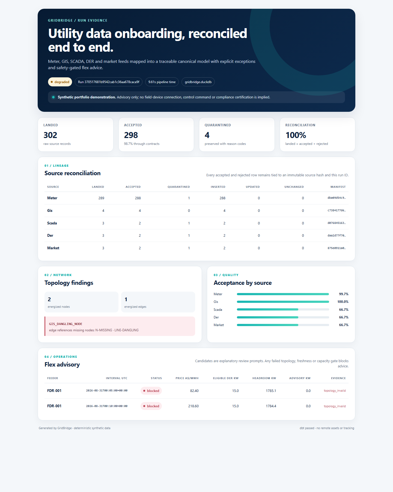
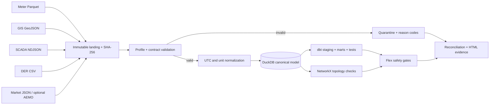

# GridBridge

[](https://github.com/SkinnyFatBoy05/gridbridge/actions/workflows/ci.yml)
[](https://www.python.org/)
[](LICENSE)

**A synthetic utility data onboarding control plane for meter, GIS, SCADA, DER and electricity-market integration.**

GridBridge turns five deliberately messy source systems into a reconciled DuckDB/dbt model, preserving rejected records with stable reason codes and immutable source hashes. It validates feeder topology, blocks unsafe flex advice, supports idempotent replay, and exposes the same pipeline through a local CLI and Apache Airflow.

> **Scope boundary:** this is a deterministic portfolio system built with synthetic data. It does not connect to utility infrastructure, issue device commands, prove utility employment, or claim ISO/IEC 27001 or NERC CIP compliance.



[Open the standalone example report](docs/examples/example-report.html)

## What it demonstrates

| Role capability | Implemented evidence |
|---|---|
| Client data onboarding | Source contracts, discovery questionnaire, mapping spec, profiles, reconciliation and replay runbook |
| Meter data and time series | Five-minute interval Parquet, UTC/DST handling, dbt feeder-load marts and a one-million-row benchmark |
| GIS network models | GeoJSON adapter plus dangling-node, connectivity, energized-path and radial-cycle checks |
| SCADA telemetry | NDJSON event ingestion, quality-code filtering, sequence checks, range checks and freshness gates |
| DER records | CSV onboarding, W/kW/MW normalization, export-limit checks and feeder capacity aggregation |
| Flex-market concepts | Five-minute AEMO-style prices joined to load and eligible DER; explainable `review`, `blocked` and `not_economic` outcomes |
| Modern integration tooling | Python, Polars, PyArrow, DuckDB, dbt-core and an Airflow TaskFlow DAG |
| Regulated-environment habits | Integrity hashes, redacted evidence, least-privilege role design, audit tables, fail-closed gates and documented incident/replay procedure |

## Five-minute quick start

Prerequisites: [uv](https://docs.astral.sh/uv/) and Python 3.12. Docker is optional.

```bash
git clone https://github.com/SkinnyFatBoy05/gridbridge.git
cd gridbridge
uv sync --frozen
uv run gridbridge demo --workspace work/demo
```

The command prints paths to:

- `work/demo/gridbridge.duckdb` — canonical and analytical data;
- `work/demo/runs/<run-id>/report.html` — standalone human evidence;
- `work/demo/runs/<run-id>/run-summary.json` — machine-readable run evidence.

Expected fixture result: 302 landed records, 298 accepted and four quarantined. The run is `degraded` by design because it contains one controlled defect in meter, SCADA, DER and market data plus a GIS topology defect.

## Architecture



The CLI and [Airflow DAG](airflow/dags/gridbridge_onboarding.py) call the same `run_demo` entry point. The repository keeps orchestration thin and business rules independently testable.

Read the deeper [architecture and lineage guide](docs/architecture.md).

## Controlled defects and resolution

| Source | Example defect | Result |
|---|---|---|
| Meter | Duplicate meter/channel/interval key | First fact accepted; duplicate quarantined as `METER_DUPLICATE_INTERVAL` |
| GIS | Energized line references `N-MISSING` | Topology issue `GIS_DANGLING_NODE`; flex advice fails closed |
| SCADA | `BAD` quality code and implausible value | Observation preserved as quarantine evidence and excluded from calculations |
| DER | Unsupported `MVA` unit | No guessed conversion; record quarantined as `DER_UNIT_UNSUPPORTED` |
| Market | Invalid NEM region | Record quarantined as `MARKET_INVALID_REGION` |

Every quarantined row retains its run ID, source record ID, stable reason code, redacted preview, payload fingerprint and source-file hash.

## Commands

```bash
# Rebuild the five small source fixtures
uv run gridbridge generate --output sample_data --seed 42

# Run onboarding
uv run gridbridge demo --workspace work/demo

# Replay and link the new audit event to an earlier run
uv run gridbridge replay --workspace work/demo --parent-run-id <run-id>

# Reproduce the interval-scale result without committing bulk data
uv run gridbridge benchmark --rows 1000000 --output work/benchmark

# Run the full engineering checks
uv run ruff format --check .
uv run ruff check .
uv run mypy src/gridbridge
uv run pytest
```

## Million-row result

On the recorded Windows 11 / Python 3.12.10 run, GridBridge generated and loaded 1,000,000 deterministic five-minute rows at approximately **1.25 million rows/second** and completed the representative feeder/day aggregation in **182 ms**. These are local observations, not universal performance claims. The method, machine context and limitations are in [the benchmark record](docs/benchmark.md).

## Airflow

The fast path needs no services. To inspect or trigger the scheduled path:

```bash
docker compose up airflow-init
docker compose up airflow-api-server airflow-scheduler
```

Open `http://localhost:8080` and trigger `gridbridge_utility_onboarding`. The compose credentials are explicitly local-demo values and must not be reused outside an isolated development machine.

## Documentation

- [Architecture and lineage](docs/architecture.md)
- [Source-to-target mapping](docs/source-to-target-mapping.md)
- [Canonical data dictionary](docs/data-dictionary.md)
- [Client onboarding questionnaire](docs/client-onboarding-questionnaire.md)
- [Data-quality reason-code catalogue](docs/data-quality-catalogue.md)
- [Operator and replay runbook](docs/operator-runbook.md)
- [Security control mapping](docs/security-control-mapping.md)
- [Production evolution](docs/production-evolution.md)
- [Interview talking points](docs/interview-talking-points.md)
- [Benchmark method and result](docs/benchmark.md)
- [Approved design](docs/superpowers/specs/2026-08-31-gridbridge-design.md)

## License

[MIT](LICENSE). Synthetic fixtures are generated by this repository. The optional AEMO adapter is not invoked by the deterministic demo; users of public AEMO data remain responsible for AEMO's applicable terms and notices.

