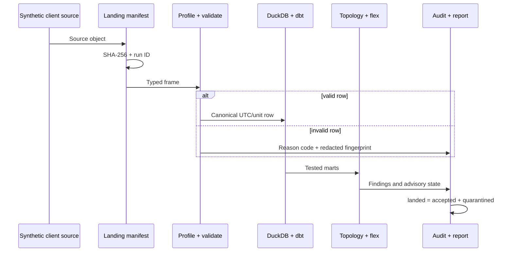

# Architecture and Lineage

## Design intent

GridBridge models the work between a client's source-system owners and a platform team. The central contract is not “a file loaded”; it is an auditable statement that every landed row became either a canonical record or an explained quarantine record.

## Component boundaries

| Component | Responsibility | Depends on |
|---|---|---|
| Generators | Create deterministic source drops and controlled defects | Standard library, Polars |
| Adapters | Convert Parquet, GeoJSON, NDJSON, CSV and JSON envelopes into frames | Source format only |
| Quality | Profile datasets and split accepted/quarantined rows | Shared reason codes |
| Canonical normalization | Convert time and units without guessing | Accepted rows, pipeline configuration |
| Warehouse | Transactional natural-key loads and operational evidence | DuckDB |
| dbt | Explicit staging, aggregation, mart grains and SQL assertions | Canonical DuckDB tables |
| Topology | Energized connectivity and radial-feeder plausibility | Canonical GIS nodes/edges, NetworkX |
| Flex | Fail-closed advisory status and explainable factors | dbt mart, topology, SCADA freshness |
| Report | Portable human evidence | Immutable pipeline summary |
| CLI/Airflow | Invoke the same composite pipeline | All stages through `run_demo` |

## Lineage sequence

Every canonical row includes `source_record_id`, `source_system`, `source_file_hash`, `_payload_fingerprint` and `_run_id`. Every quarantine row includes equivalent source/run evidence plus a stable reason code.

## Time and unit semantics

- Naive Sydney timestamps are interpreted with `Australia/Sydney` only when unambiguous.
- Repeated daylight-saving times require an explicit UTC offset; GridBridge refuses to guess.
- UTC is the canonical timestamp zone.
- Power is normalized to kW; interval energy is normalized to kWh. They use different conversion functions and tests.
- Five-minute kWh becomes interval-average kW only in the documented dbt expression `energy_kwh * 60 / interval_minutes`.

## Failure model

Row-level defects become quarantine evidence. Contract parse failures, reconciliation imbalance, dbt test failures and missing accepted SCADA observations fail the run. Controlled row defects and topology findings create a `degraded` run; topology, freshness and capacity findings independently block flex advice.

## Market boundary

The default demo uses a deterministic REST-style JSON fixture. The optional adapter parses the public AEMO NEMWeb DispatchIS ZIP/CSV envelope and is tested through an injected HTTP boundary, so CI never depends on live market availability. AEMO describes NEM data and public current/archive reports on its [official NEM data page](https://www.aemo.com.au/energy-systems/electricity/national-electricity-market-nem/data-nem) and [NEMWeb interface](https://visualisations.aemo.com.au/aemo/nemweb/index.html).

